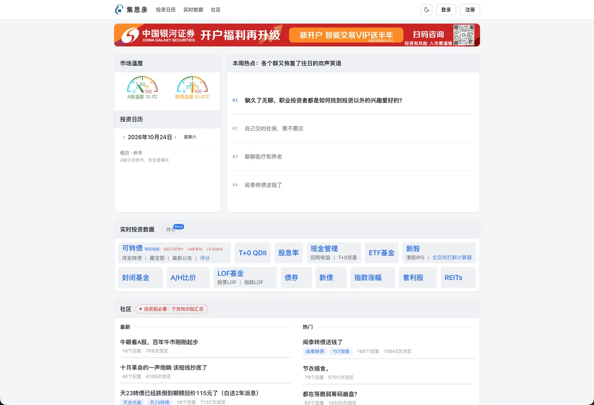
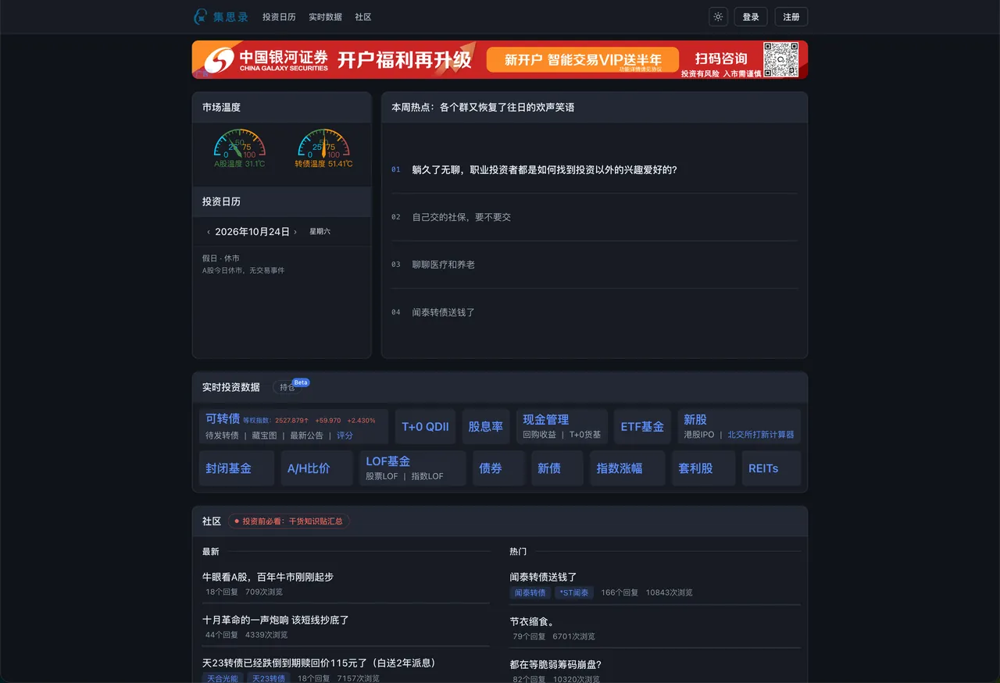
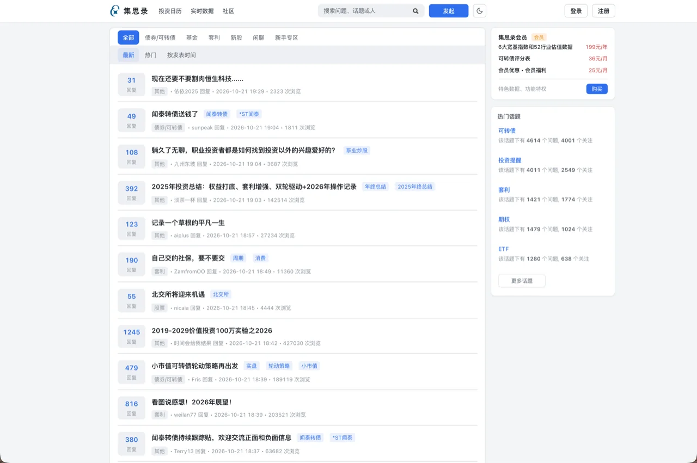
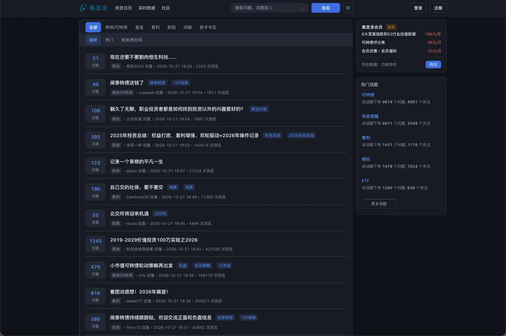
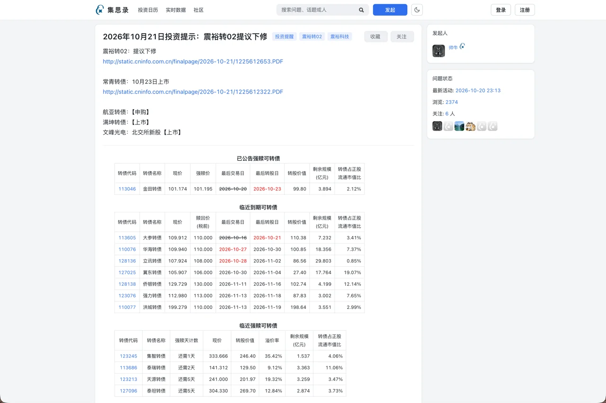
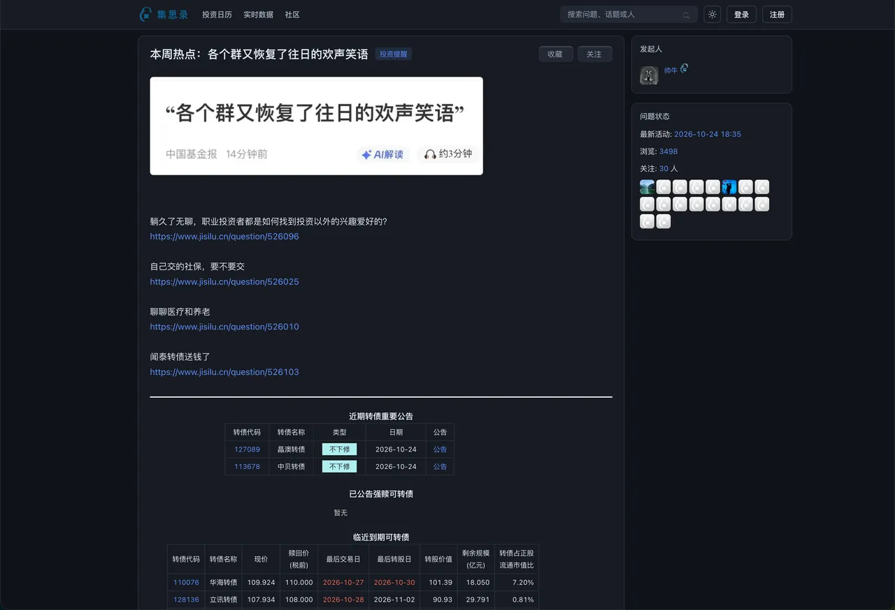

# JSL UI Plugin · 集思录现代化

为 [集思录](https://www.jisilu.cn/) 社区做的界面现代化 Chrome 扩展：统一深浅双主题、卡片语言与阅读排版，不改变站方功能。思路致敬 [V2EX_Polish](https://github.com/coolpace/V2EX_Polish)。

## 截图

深浅两套主题共享同一布局，只换配色；顶栏的太阳 / 月亮按钮可随时切换。

|  |  |
|-----------------------------------------------------|----------------------------------------------------|
| **门户首页 · 浅色**                                 | **门户首页 · 深色**                                |

|  |  |
|-----------------------------------------------------|----------------------------------------------------|
| **社区列表 · 浅色**                                 | **社区列表 · 深色**                                |

|  |  |
|-------------------------------------------------------|------------------------------------------------------|
| **帖子详情 · 浅色**                                   | **帖子详情 · 深色**                                  |

## 页面覆盖

| 页面                                        | 状态   |
| ------------------------------------------- | ------ |
| 广场 / 列表 / 详情 / 话题 / 收藏 / 我的首页 | 已覆盖 |
| 通知 / 私信 / 个人主页 / 设置（8 tab）      | 已覆盖 |
| 门户首页 / 登录注册 / 投资日历 / 搜索结果   | 已覆盖 |
| 实时数据页 / 旧版服务端数据页 / 持仓        | 已覆盖 |
| 发帖编辑器深度适配                          | 计划中 |

## 安装

扩展尚未上架 Chrome Web Store(进行中)，目前从源码构建：

```bash
git clone https://github.com/jluncc/jsl-ui-plugin.git
cd jsl-ui-plugin
pnpm install
pnpm build
```

1. 打开 `chrome://extensions/`，开启右上角「开发者模式」
2. 点击「加载已解压的扩展程序」，选择本项目的 `dist/` 目录
3. 打开 [集思录](https://www.jisilu.cn/) 查看效果；点击工具栏图标进入设置

需要 Chrome 114+（扩展使用了 `:has()` 等较新的 CSS 能力）。Edge 等其他 Chromium 浏览器未做系统验证。

## 权限与隐私

扩展只申请两项最小权限：

| 权限                      | 用途                                                                        |
| ------------------------- | --------------------------------------------------------------------------- |
| `storage`                 | 在 `chrome.storage.sync` 中保存总开关、主题与模块设置（可随浏览器账号同步） |
| `https://www.jisilu.cn/*` | 在集思录页面注入样式与 DOM 增强                                             |

明确边界：

- **不读取** Cookie、密码或表单输入值、浏览历史、剪贴板；不采集、不上报任何页面数据或使用统计。DOM 增强只读取页面可见结构（标题、导航文案、楼层等）用于重排，读到的内容不出页面。
- **不加载远程代码**，扩展自身运行时不发起任何网络请求；所有样式与脚本都打包在扩展内。
- 仅写入集思录域下的 `localStorage` 键 `jsl-polish-theme` / `jsl-polish-enabled` / `jsl-polish-settings`，用于首帧防闪与设置镜像。这些只是缓存，清除后下次加载会从 `chrome.storage.sync` 重新写入；真正的设置在扩展设置页里。
- 仓库中的 `scripts/refresh-calendar-events.mjs` 是**开发辅助脚本**，只会在手动运行时请求集思录公开日历接口抓预览数据，扩展本身不会调用它。

## 开发

```bash
pnpm dev         # watch 构建，改完在 chrome://extensions/ 点刷新 + 刷新网页
pnpm build       # 构建 dist/
pnpm lint        # eslint + tsc --noEmit
pnpm format      # prettier
pnpm audit:code  # 零依赖源码体检（危险 API / XSS 面 / CSS 冗余 / 体积预算）
```

### 目录结构

```
├── static/                  # manifest.json、options.html、图标；构建时原样复制进 dist/
├── scripts/
│   ├── audit.mjs            # 非功能性体检
│   ├── preview.sh           # 页面快照 + 扩展样式 → 本地预览页
│   ├── diagnose.sh          # 预览页几何诊断
│   └── refresh-calendar-events.mjs
├── src/
│   ├── content/
│   │   ├── index.ts         # 页面识别、标志挂载、设置应用、模块分发
│   │   ├── theme.ts         # 主题解析 + 首帧防闪 + 系统偏好监听
│   │   └── modules/         # list / detail / portal / settings / theme-toggle
│   ├── options/             # 设置页逻辑
│   ├── background/          # 点击工具栏图标打开设置页
│   ├── shared/settings.ts   # 设置 schema + chrome.storage / localStorage 镜像
│   └── styles/              # tokens.css → global.css → community.css
├── dist/                    # pnpm build 产物（不入库）
└── AGENTS.md                # 项目笔记、站方样式陷阱与验收流程
```

## 贡献

欢迎 Issue / PR。提交前请确保：

1. `pnpm lint` 与 `pnpm audit:code` 通过
2. `pnpm build` 成功，并在真实页面（或按上述预览流程）验证过深浅两套主题
3. 不提交页面快照、Cookie、账号信息、`inject.js` 或其他本地调试产物
4. 新增页面适配时同步更新 `AGENTS.md` 的覆盖范围与陷阱清单

## 许可

[ISC](LICENSE)。集思录名称、页面内容与相关素材归其权利人所有；本项目仅提供界面增强代码。
